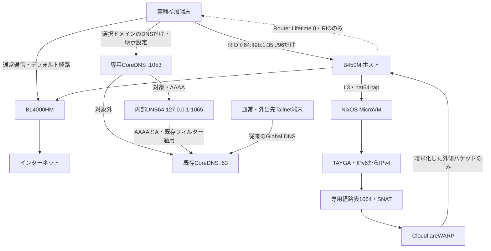

# 指定ドメイン用DNS64・NAT64実験

この構成は既存のGlobal DNS、BL4000HM、DHCP、デフォルトゲートウェイを維持し、参加を明示したLinux端末の指定ドメインだけをNAT64ゲストへ送る。全機能はデフォルト無効。ホスト設定には有効化を追加していない。実機への適用、RA送信、Cloudflare登録・接続は本作業では行わない。

## 通信経路とDNSの分離



既存の`100.111.109.43:53`にはDNS64を追加しない。`infra/tailscale/dns.tf`も変更しない。送信元のTailscale IPから在宅かどうかを推定しない。専用サービスの初期待受は`127.0.0.1:1053`で、ファイアウォールも自動開放しない。通常サービスと独立したプロセスなので、専用Corefileの構文エラーでGlobal DNSが停止することも避けられる。

実験端末では、承認後にsystemd-resolvedのドメイン別DNSを専用エンドポイントへ向ける。`1053`番ポートを利用できるローカルDNSプロキシ／resolved設定が必要。Tailscale Global DNSにこのポートを追加する方式ではない。公開する場合はB450Mの**確認済みLANアドレス**へbindし、実験端末の送信元からだけUDP/TCP 1053を許可する。既存の53番開放を1053番へのアクセス許可と取り違えない。

持ち出す前に専用DNS設定を削除し、キャッシュを破棄する。専用DNSを明示利用した端末は、外出先では合成AAAAへ到達できない。通常のTailnet端末への影響を分離した設計であり、実験端末の自動在宅判定は実装していない。NAT64プレフィックスのTailscale広告も追加しない。

## 調査の根拠と未確認事項

2026-11-17時点の作業ツリーを読んだ。既存の未コミット変更は保持した。過去資料のネットワーク状態を現在の実測として扱っていない。

| 項目 | 今回の確認 |
| --- | --- |
| B450MのWi-Fi | 宣言はwpa_supplicant + networkd。11月12日の記録は`wlp2s0f0u5`。今回のSSH読み取りはTailscale追加認証で停止し、現在のNIC・経路・稼働世代は未確認 |
| 既存CoreDNS | 作業ツリーではQuad9優先、Cloudflareへ障害時転送。広告・CNAMEフィルター、stale cache、ホームドメイン、MagicDNSあり。11月12日のGoogle優先という記録とは時点が異なる |
| パッケージ | ロック入力のNixpkgsからCoreDNS 1.14.7、TAYGA 0.9.6、WARP 2026.8.2115.0。CoreDNSの`-plugins`で`dns64`を確認 |
| AP | 過去資料ではArcher C6。現行firmware、AP isolation、RA Guard、Wi-Fiマルチキャスト転送は未確認 |
| IPv6 VLAN資料 | 有線namespaceでの過去の検証。Wi-Fi STAからのRAや今回のRIOを証明しない |

### RIOとWi-Fiの成立条件

通常のSTAインターフェースからIPv6マルチキャストを送信する構成で、VMのMACをWi-Fiにブリッジしない。ただしArcher C6が別STAへRAを中継するかは、APの設定と実機で確認する必要がある。今回はLANへのRA送信を許可されていないため、成立したとは記載しない。

| 端末 | `/96`の扱い |
| --- | --- |
| Linux kernel RA | `accept_ra=2`、`accept_ra_rtr_pref=1`、`accept_ra_rt_info_max_plen=128`が必要になり得る。networkd/NetworkManagerがRA処理を所有する場合はその設定と実際の経路表で確認する |
| Android 16 | AOSP netdはRIOを`/48`〜`/64`に制限する。今回の`/96`広告をそのまま受理する前提にしない |
| Windows | Windowsの版・NIC・ポリシーを特定して`Get-NetRoute -AddressFamily IPv6`とパケットキャプチャで確認。今回の実機検証なし |
| iOS/macOS | Apple公開XNUにはRIO処理があるが、端末OSの版と今回の広告の受理は別問題。今回の実機検証なし |

Android対応のために広告範囲を勝手に`/64`へ拡大していない。家族の端末は参加条件にしない。RA自体は同じLANの端末にも届くが、DNSを変えなければ通常の宛先は変わらない。参加端末以外からの合成プレフィックス宛転送はホストで拒否する。

APがRAを中継しない場合の選択肢は、(1) B450Mを有線へ移す、(2) 有線接続の別ホストへNAT64 VMとradvdを置く、(3) 実験Linux端末だけに明示経路を設定してNAT64単体を検証する、の順で検討する。(3)はRIOの検証完了を意味しない。いずれもBL4000HMの設定変更やデフォルト経路変更は不要。

## DNS64の挙動

`my.services.dns64`は独立して有効化できる。`domains`の既定値は空で、有効化時には明示指定を要求する。例は次のとおり。

```nix
my.services.dns64 = {
  enable = true; # 承認後のローカル実験設定だけに記載
  domains = [ "chatgpt.com" "challenges.cloudflare.com" "trycloudflare.com" ];
  # 最初は127.0.0.1:1053のままローカル照会で検証する。
};
```

対象名とその配下には`translate_all`を使い、ネイティブAAAAが存在してもAから合成する。`allow_ipv4`はIPv4で受けたDNS照会にも合成を行うために必要で、今回の内部転送もIPv4 loopbackを使う。これらを無効にした場合の応答差は自動テストに含める。

対象のA・HTTPS・SVCBはNOERRORの空応答にする。ANYはHINFOへ書き換えて空応答にする。A抑制を合成器の手前の別サーバーブロックに置くため、合成器自身のA照会を抑制しない。HTTPS/SVCBを抑制するのは、`ipv4hint`・`ipv6hint`や別名を使って通常出口が選ばれるのを減らすためで、HTTP/3などへの影響も実験時に比較する。

既存CoreDNSへAAAAとAを問い合わせるので、広告フィルター、CNAMEブロック、allowlist、ホーム・MagicDNS処理を再利用する。専用サービスは合成応答をキャッシュせず、TTLを30秒以下に制限する。通常CoreDNSのstale cacheは保持するため、上流障害時の古いAから合成する場合はある。CoreDNSの実行順はCorefileの記述順ではなく組み込みplugin順で決まる。抑制・合成・既存解決を別段に分け、この依存を明示した。

CNAMEとAが同じ応答に含まれるCDNチェーンは合成対象になる。ブラウザーがCNAME先を独立した名前で再問い合わせすれば、その名前が対象外である限り通常解決になる。CNAMEだけを返す不完全な応答、別ドメインの認証・静的資産、アプリ内DoH、IPリテラル、既存接続、DNSキャッシュは別に確認する。これはドメイン指定による実験であり、通信の強制隔離・アクセス制御ではない。

CoreDNS dns64はDNSSEC検証に対応した完全なDNS64実装ではない。合成したAAAAに有効なRRSIGはなく、合成応答にADを立てないことをテストする。クライアント側で検証するリゾルバーとの互換性は保証しない。署名検証を全体で無効化する変更はしない。

### 初期ドメインの範囲

OpenAI公式のネットワーク資料には`chatgpt.com`以外にも`auth.openai.com`、`oaistatic.com`、`oaiusercontent.com`等の依存先がある。到達許可リストをそのままWARP対象へ変換しない。最初は再現に必要な名前だけを追加し、ブラウザーのnetwork logで失敗先を特定する。`challenges.cloudflare.com`は他サイトも共有するため、対象化するとChatGPT以外のchallenge通信にも影響する。

TryCloudflareは、可能なら実際の`<random>.trycloudflare.com`だけを指定する。ゾーン全体の指定は全Quick Tunnelを含む。429はQuick Tunnelの同時リクエスト上限などでも発生し、出口変更で解消するとは限らない。登録APIの宛先と公開トンネルの宛先も同一とは限らない。`Retry-After`を尊重して比較し、CAPTCHA自動承認や制限解除を実装しない。

## NAT64ホストとゲスト

`my.services.nat64Warp.enable`、`.rio.enable`、`.warp.enable`の既定値はすべてfalse。通常のIPv4出口でNAT64を検証し、その後WARPを有効化する。`warp.enable=false`は明示的なNAT64単体モードであり、WARP障害時にこのモードへ自動移行しない。

```nix
my.services.nat64Warp = {
  enable = true;
  lanInterface = "wlp2s0f0u5"; # 実機で確認してから設定
  clients = [ "2001:db8:1::10/128" ]; # 文書用例。実験端末の実アドレスへ置換
  rio.enable = false; # 最後に個別承認・AP確認を経て有効化
  warp.enable = false; # 最初はNAT64単体
};
```

TAPは`192.168.254.1/30`と`fd64:35::1/64`、ゲストはそれぞれ`.2`と`::2`。固定範囲と既存の全経路表が重なる場合、preflightが起動を拒否する。ポリシールール優先度1064の競合も拒否する。設定後に増えるVPN・コンテナー経路までは予測できないので、実験前と構成変更後に再点検する。

ホストは合成プレフィックスだけを専用経路表1064からゲストへ送り、ゲストの外側IPv4はmainテーブルを参照する。これにより通常のTailscaleの経路選択は維持する。実際のTailscaleルール・DockerのFORWARD DROP・nft hook優先度との共存は実機前に再確認する。ホスト全体のfirewall backendを変更せず、専用nftテーブルと送信元・宛先・NICを限定したiptables/ip6tables規則を追加する。

ゲスト内のTAYGAは保守されているapalrd版0.9.6を使用する。ユーザー空間で動き、NixOSの既存モジュールがTUN・経路・サービスを管理するため、最初の小規模実験に採用した。動的IPv4プールは`192.0.2.0/24`で、ゲストの外へ出す前に出口NICへmasqueradeする。TAYGAのアドレス対応とLinux conntrackのNAPTを組み合わせ、戻りパケットをIPv6へ戻す。Joolはカーネル内のstateful NAT64として性能面の候補だが、カーネルモジュール管理を増やすため今回は採用しない。

戻りIPv6には参加端末のプレフィックスごとのホスト向け経路を設定する。LAN側の新しいプレフィックスやprivacy addressを使う端末は許可リスト更新が必要。NDP proxy、PIO、DHCP、NAT66、Wi-Fiブリッジは使わない。

ゲストのforwardは既定拒否。LAN→合成プレフィックス→TUN、TUN→指定IPv4出口、およびその戻り通信だけを許す。RFC1918・CGNAT/Tailnet・loopback・link-local・multicast等への変換後通信を拒否する。ホストもTAPから別LAN、Tailscale、コンテナーへの転送を拒否する。

RIOはRouter Lifetime 0、有効期間90秒、送信間隔10〜30秒、`RemoveRoute on`。正常停止時は撤回し、異常停止では最後の広告から最大90秒残る。PIO・RDNSSを追加しない。WARP停止中もRIOは残し、対象通信は失敗させる。DNSを通常へ戻すのは利用者の明示操作とする。ホストではIPv6のglobal forwardingを有効にし、他NICとdefaultの個別forwarding値は保存値へ戻す。LAN/TAPの個別IPv4・IPv6 forwardingを有効にし、対象NICの`accept_ra=2`を設定する。変更前の値を`/run/nat64-host`へ記録し、サービス停止時に復元する。networkd等がRAを処理する環境ではkernel sysctlだけでは十分でないため、HGW経由のデフォルト経路が更新されることを確認する。

## WARP出口の選択

| 方式 | 今回の扱い |
| --- | --- |
| 公式WARPクライアント | NixpkgsのheadlessパッケージとNixOSサービスをゲスト内で使用。公式の登録・MASQUE/WireGuard制御を利用できる。ただしNixOS自体とこの転送用途が公式サポート対象とは断定しない |
| WARP Connector / Mesh node | ルーティング用途に沿うがCloudflareアカウント・組織設定が増える。公式Linux対応表にNixOSはない。Mesh構築を目的にしないため自動導入しない |
| 非公式WireGuardプロファイル | 経路を管理しやすいが、登録API・鍵取得方法・現行利用条件に依存する。wgcfによる登録や非公式APIを実装しない |

採用したのは公式クライアントを隔離ゲストに置く方法。実サービスの転送可否は承認後の検証事項であり、模擬WireGuard出口の成功をCloudflareの動作保証と取り違えない。公式の対応OSを必須にする場合は、ゲストOS／Mesh node方式を再検討する。

WARP用の経路表はTUNから来たIPv4だけに適用し、デーモンが作るトンネル外側パケットには適用しない。再接続で`CloudflareWARP`が作り直されたときは1秒周期で出口経路を復元する。IPv4アドレスがない間はunreachable経路だけを保持する。転送フィルターもWARP以外への出口を拒否するため、デーモン停止時に通常回線へ自動漏出しない。インターフェースが残っていても実トンネルが故障していれば通信は失敗する。経路監視はWARPの健全性監視ではない。

ゲスト全体の経路／DNSをwarp-svcが変更しても、ホストとTailnetのDNSには波及しない。WARP自身が追加するnft規則やポリシールールとの互換性、再帰ルーティングがないこと、翻訳後の送信元が受理されることは実接続時の必須確認項目。単に`warp-cli status`がConnectedであるだけでは完了としない。

登録・`warp-cli connect`はサービス起動スクリプトに含めない。承認後、`my.services.nat64Warp.authorizedKeys`へ管理用の公開鍵を設定し、ホストから`ssh root@192.168.254.2`でゲストへ入り、利用条件と`warp-cli --help`を確認して操作する。SSHはゲストのTAP側IPv4だけで待受け、LANからの新規転送はホストで拒否する。秘密鍵はコピーしない。WARP有効化には公開鍵の明示設定を要求する。状態はゲストの永続`/var/lib/cloudflare-warp`（0700）に保持し、ホスト側VMディレクトリも0700にする。秘密鍵・登録情報をNix文字列、Git、`/tmp`へ書かない。復旧はVMの永続state volumeを保護して保管・復元するか、承認の上で再登録する。組織トークンを採用する場合は別途sops-nixからruntimeファイルとして渡し、平文のオプションを追加しない。

## MTU・PMTUD

初期TUN MTUは1280、IPv4出口へ送るTCP SYNのMSS上限は1220にする。これは最適値の測定結果ではなく、IPv6側の最小MTUを基準にした保守的な初期値。ICMP/ICMPv6とconntrack relatedを許し、TAYGAによるエラー変換を利用する。MSS調整はUDP/QUICのPMTUDを代替しない。

実接続では外側・内側のMTUを読み、`tracepath`、DF付きIPv4 ping、IPv6 ping、大きなHTTPS転送、UDP/QUICを比較する。Packet Too BigやFragmentation Neededが戻るかを両NICで確認する。速度だけを見てMTUを上げない。

## テストと導入の順序

隔離されたVMテストは実機のLANへ接続しない。Cloudflareへの接続・登録も行わない。

```sh
nix build 'path:.#checks.x86_64-linux.coredns' -L --no-link
nix build 'path:.#checks.x86_64-linux.dns64' -L --no-link
nix build 'path:.#checks.x86_64-linux.nat64-eval' -L --no-link
nix build 'path:.#checks.x86_64-linux.nat64-direct' -L --no-link
nix build 'path:.#checks.x86_64-linux.nat64-warp' -L --no-link
```

未追跡の新規ファイルも評価するため、レビュー中は`path:.`を使う。通常のflakeチェックをmainへ追加しても、ホスト設定にenableがなければLAN広告・ゲスト・専用DNSは起動しない。

### 今回の実行結果（2026-11-17）

| 検証 | 結果・範囲 |
| --- | --- |
| 既存CoreDNS回帰 | 実パッケージと生成済みフィルターポリシーで7テスト成功 |
| 専用DNS64 | 既存7件を含む15テスト成功。対象／対象外、TCP/UDP、A・HTTPS・SVCB・ANY抑制、translate_all・allow_ipv4、CNAME、ブロック、AD消去を検証 |
| NAT64単体・QEMU VM | 成功。4台の隔離VMでRIO、既存default維持、HTTP/ICMP往復、SNAT、private宛拒否、大きな転送、MSS 1220、PMTU 1280、ICMPエラー変換、firewall再起動を検証 |
| 模擬WARP・QEMU VM | 成功。同じゲストモジュールと実WireGuardトンネルで出口を確認。トンネル削除時の遮断、通常通信の維持、再作成後の復旧、経路サービス停止時の遮断を検証 |
| 停止・復元 | 両VMテストでRIO撤回、default維持、保存したsysctl全項目の復元、専用経路ルールとnftテーブルの削除を確認 |
| モジュール評価 | 無効時のsystem closureが未導入時と同一。有効時のホスト・WARPゲストのtoplevel derivation評価も成功 |
| B450M構成評価 | DNS64・NAT64・RIO・WARPのenableはすべてfalse |

DNSテストはNixビルドの隔離環境で実CoreDNSと模擬上流を動かす統合テスト。実Tailnetへ外出先端末を接続した試験ではない。通常DNSに合成AAAAが出ないことを検証し、Global DNSの宣言には変更を加えていない。AD消去の試験も、インターネット上の署名チェーンを検証したことを意味しない。

ネットワークVMテストではTAP相当の独立L2区間を使い、ホスト・ゲストの本実装を読み込む。microvm.nixのゲスト起動、永続volume、virtiofs、実warp-svcの経路変更は別途実機前に検証が必要。Wi-Fi AP、実Tailscale/Dockerとの共存、QUIC、Windows/Android/iOS、実サービスのドメイン依存、CAPTCHA・429の変化は未検証である。

実機導入は別途承認後、次の順序で行う。

1. 現在のNIC、全IPv4/IPv6経路・ルール、firewall、Tailscale DNS、既存サービス状態を保存する。APの隔離・RA Guardを確認する。既知の正常なsystem closureと物理コンソールを確保する。
2. Cominを一時停止し、mainにはenableを入れずローカルの実験設定をビルドする。無効版との差分をレビューする。独立した自動切り戻しタイマーを準備してから、別途承認された手順で適用する。
3. RIOもWARPも無効のままゲストを起動し、専用DNSをloopbackで照会する。実験端末の明示経路でNAT64単体の往復・SNAT・拒否範囲を確認する。
4. AP側と実験端末でキャプチャを開始し、承認されたRIOだけを有効化する。RAの送信元、Lifetime 0、RIO `/96`、PIO/RDNSSなし、既存デフォルト経路維持を確認する。確認できなければ停止して有線化等を選ぶ。
5. WARP登録・接続を別途承認後に実行する。数値IPv4、合成IPv6、実対象名の順で出口を比較する。停止・再起動、再接続、firewall再読込、Docker/Tailscale再起動、MTU、既存サービスを確認してから実験端末だけのDNS設定を追加する。

## 切り戻し

最初に参加端末の専用DNS設定を削除し、DNSキャッシュと既存接続を破棄する。radvdを正常停止してRIO撤回を確認し、届かなければ90秒待つ。専用DNSとNAT64を無効化した既知の正常構成へ戻す。ホストサービスは停止時にTAPをdownにしてから専用ルール・経路・アドレス・nftテーブルを削除する。無効化でゲストを停止しても、登録情報を含む永続volumeは自動削除しない。

その後、HGW経由のデフォルト経路、既存CoreDNS、Tailscale、コンテナー通信、実験用ルールの消失を確認する。承認前に記録したsysctl／networkd状態も比較する。ホストのsysctlは停止時に保存値へ復元する。Cominの追跡設定が無効であることを確認してから再開する。BL4000HM・DHCP・家族端末には切り戻し操作は不要。

## 監視

専用DNSの`127.0.0.1:9154`から`coredns_dns64_requests_translated_total`等を取得できる。既存CoreDNSの9153と分離した。まだscrape jobは追加していない。専用nftテーブルには変換／拒否カウンターがあり、NICごとのbyte counterとsystemdの状態も収集可能。nftテーブルの置換でカウンターはリセットされる。通常のWi-Fiトラフィック総量をWARP転送量とみなさない。

## 参考資料

- [CoreDNS dns64](https://coredns.io/plugins/dns64/)と[1.14.7実装](https://github.com/coredns/coredns/blob/v1.14.7/plugin/dns64/dns64.go)：合成条件・DNSSEC制約・メトリクス。
- [参考DNS設定](https://github.com/nyanshiba/corednsconf)、[NAT64/RIO例](https://github.com/nyanshiba/nat64-on-link)、[WARP例](https://github.com/nyanshiba/warp-router)、[指定commit](https://github.com/nyanshiba/warp-router/commit/afe1f60e30526c8a77874f876ba01f2aeeafd1db)。参考例の広いRIO、RDNSS、MITM、AS単位経路、DSCP操作は導入していない。
- [Linux IPv6 sysctl](https://www.kernel.org/doc/html/latest/networking/ip-sysctl.html)、[RFC 4191](https://www.rfc-editor.org/rfc/rfc4191.html)、[Android 16 netd](https://android.googlesource.com/platform/system/netd/+/refs/tags/android-16.0.0_r1/server/InterfaceController.cpp)、[Apple XNU](https://github.com/apple-oss-distributions/xnu/blob/main/bsd/netinet6/nd6_rtr.c)。
- [TAYGA](https://github.com/apalrd/tayga)、[Jool](https://www.jool.mx/en/intro-jool.html)、[microvm.nix](https://microvm-nix.github.io/microvm.nix/declaring.html)。
- [WARP Linux](https://developers.cloudflare.com/warp-client/get-started/linux/)、[Mesh対応OS](https://developers.cloudflare.com/mesh/guides/run-mesh-on-linux/)、[WARP利用条件](https://www.cloudflare.com/application/terms/)、[OpenAIネットワーク資料](https://help.openai.com/en/articles/9247338-network-recommendations-for-chatgpt-errors-on-web-and-apps)、[Quick Tunnel](https://developers.cloudflare.com/cloudflare-one/networks/connectors/cloudflare-tunnel/do-more-with-tunnels/trycloudflare/)。

### 参加Linux端末の設定例（実機承認後のみ）

RIOの経路と通常デフォルト経路を確認してから、確認済みの値を次のプレースホルダーへ入れる。Tailscaleの`~.`は残し、対象ドメインだけをより具体的なDNSルーティングにする。NetworkManager／networkdが設定を上書きする場合は、その端末の管理方式で宣言する。

```sh
lab_if='<実験端末のWi-Fi NIC>'
lab_dns='<B450Mの専用DNSをbindしたLAN IPv4>'
resolvectl status "$lab_if"                 # 元の設定を記録
ip -6 route show                            # /96 とHGWのdefaultを確認
sudo resolvectl dns "$lab_if" "$lab_dns:1053"
sudo resolvectl domain "$lab_if" '~chatgpt.com' '~challenges.cloudflare.com' '~trycloudflare.com'
sudo resolvectl default-route "$lab_if" no
sudo resolvectl flush-caches
```

切り戻しでは`sudo resolvectl revert "$lab_if"`と`sudo resolvectl flush-caches`を実行し、元のリンク設定・TailscaleのDNS経路へ戻ったことを確認する。これらのコマンドは本作業では実行していない。DNS64エンドポイントへ届くことだけでは参加条件を満たさず、RIOとIPv6送信元の許可も必要になる。
