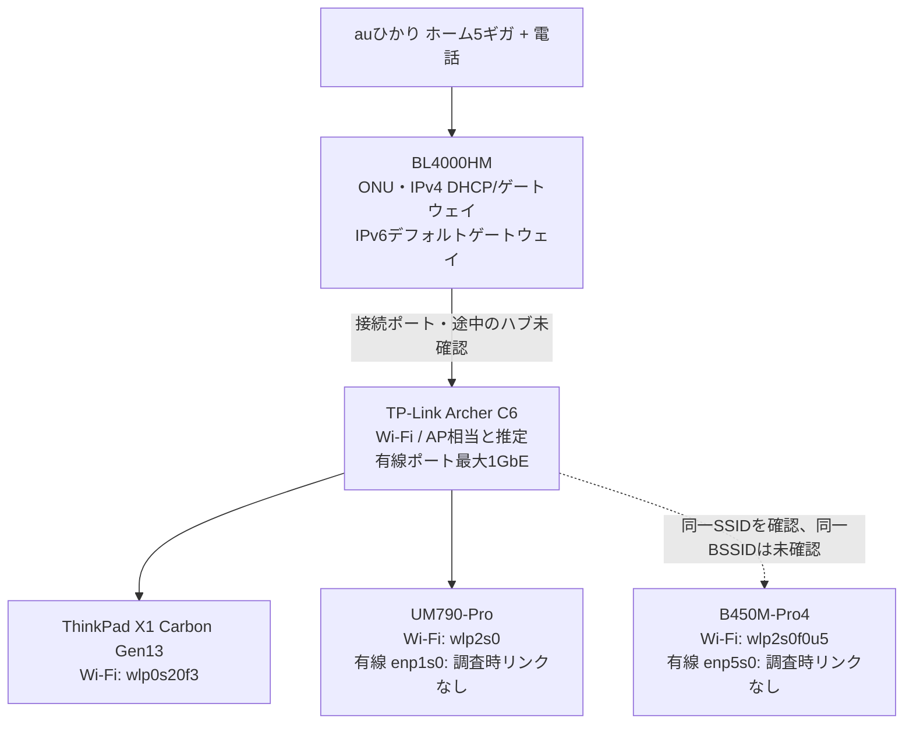
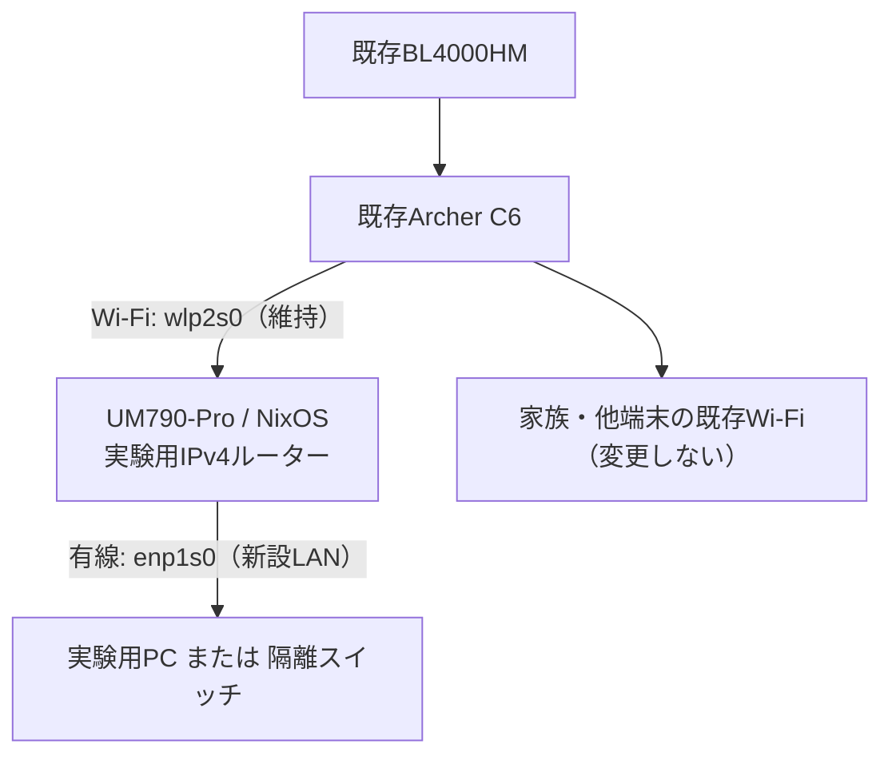
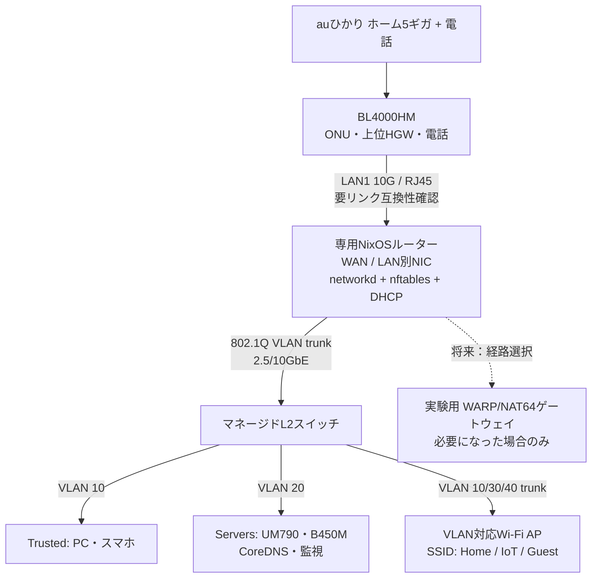

# 自宅ネットワーク構成調査（識別情報マスク版）

調査日：2026年11月12日（日本時間）／資料更新：2026年11月14日

追補資料：ユーザー提供の `home-network-baseline-and-router-plan.md`（2026-11-14）。契約画面・本体ラベルの確認結果は同資料の記録を採用し、今回その画像原本を再確認したものではない。経路・接続状態は、別記がない限り11月12日の実測として読む。

対象：KDDI／@nifty回線、BL4000HM、TP-Link、主要NixOSホスト、既存Grafana基盤

公開用に内部IP・内部サブネット、MAC／BSSID、SSID、固有のDNSドメインを役割名のプレースホルダーへ置換した。同じ記号は同じ対象を表す。URL内のプレースホルダーは実アドレスへ置換しないと使用できない。機種名・既存リポジトリのホスト名・インターフェース名と、公開DNS／Tailscale DNS／ループバック等の共通アドレスは説明のため残している。

## 1. 調査結果

追補資料では、契約は **auひかり ホーム（5ギガ）、インターネット＋電話** と確認されている。ISPの@niftyは引き続き申告情報。実験用ルーターはコードとVM検証が用意されているが、UM790-Proでは無効のままである。

主要ホストのIPv4・IPv6のデフォルトゲートウェイは、いずれもBL4000HMを指している。Wi-Fiを提供するTP-Link機器は **Archer C6** で、管理用IPv4アドレスは `<AP_IPV4>`。ThinkPadとUM790-Proは同じArcher C6の5GHzアクセスポイントに接続している。

Archer C6は、観測した端末の経路ではブリッジ／アクセスポイントとして機能していると推定できる。管理画面の動作モード表示は未確認だが、端末はC6の内側の別サブネットに収容されておらず、BL4000HMから直接DHCP設定を受けている。

Grafanaでサーバーごとの送受信量を表示するためのデータは、すでにVictoriaMetricsに存在する。通信先別の可視化には追加の収集が必要である。BL4000HMには、公開された利用者向け設定としてsFlow送信機能を確認できなかった。

### 証拠の区分

| 表記           | 意味                                                                   |
| -------------- | ---------------------------------------------------------------------- |
| 実測           | 稼働中のホスト、管理画面の未認証情報、Grafanaのデータソースで確認      |
| 設定           | dotnixの宣言的設定を確認。実際の全動作の確認とは区別する               |
| 公式仕様       | メーカー・事業者の公開資料に記載                                       |
| 推定           | 実測から導いた構成。設定画面や配線そのものは未確認                     |
| 申告           | ユーザーから提供された情報                                             |
| 画像確認の記録 | 追補資料にある契約画面・本体ラベルの確認結果。今回の原本再確認ではない |
| 未確認         | 管理画面、配線、実機試験などによる確認が必要                           |

## 2. 論理的な接続構成

以下は論理的な接続関係であり、途中にあるハブや中継機、使用ポートをすべて特定した物理配線図ではない。



図の編集用ファイル：[3段階の構成図](topology/home-network-plan.drawio)。既存のnix-topology生成SVGは設定から生成した図として残し、この実測・計画図とは区別する。

KDDI・@nifty・TP-Linkは直列に並ぶ3台のルーターという意味ではない。@niftyは契約上のプロバイダー、TP-Linkは宅内機器のメーカーとして申告されている。11月12日時点では契約プランが未確認だったが、11月14日の追補資料でホーム5ギガと電話契約を確認済みに更新した。@niftyとの契約の照合は未実施。

BL4000HMがONUを内蔵することは[au公式の接続設定ガイド](https://www.au.com/content/dam/au-com/support/internet/guide/modem/bl4000hm/pdf/bl4000hm_guide_a07dbaf35c27551c.pdf)で確認した。

### 契約とHGWの仕様（11月14日追補）

| 項目                | 確認内容                                       | 根拠・残る確認                                            |
| ------------------- | ---------------------------------------------- | --------------------------------------------------------- |
| 回線契約            | auひかり ホーム（5ギガ）、インターネット＋電話 | 追補資料の契約画面確認記録。実効5Gbpsを保証する値ではない |
| HGW                 | HGW-BL4000HM / KTH-BL4000HM                    | 本体ラベル確認記録。提供元KDDI、製造元Sercomm Corporation |
| ONU・ルーター・電話 | BL4000HMに搭載                                 | au公式仕様。電話機の実配線は未確認                        |
| LAN1                | RJ45、10/5/2.5/1GbE・100Mbps対応               | au公式取扱説明書。使用状況・交渉速度は未確認              |
| LAN2〜4             | 最大1GbE                                       | au公式取扱説明書                                          |
| 内蔵Wi-Fi           | Wi-Fi 7対応                                    | au公式仕様。オプション契約・有効化状況は未確認            |

仕様は[au製品情報](https://www.au.com/support/service/internet/guide/modem/bl4000hm/)と[取扱説明書](https://www.au.com/content/dam/au-com/support/internet/guide/modem/bl4000hm/pdf/bl4000hm_manual_eb2392312d264e12.pdf)を参照。氏名・住所・電話番号・機器の認証情報・画像原本は収録しない。

## 3. 機器とアドレス

| 機器                     | IPv4             | 接続・役割                                        | 根拠                                                          |
| ------------------------ | ---------------- | ------------------------------------------------- | ------------------------------------------------------------- |
| BL4000HM                 | `<HGW_IPV4>`     | 主要ホストのIPv4・IPv6ゲートウェイ、DHCPサーバー  | 経路表・DHCP情報。Web画面にKDDI・BL4000表記、機種は会話で確認 |
| TP-Link Archer C6        | `<AP_IPV4>`      | ThinkPad・UM790のWi-Fi接続先に対応する管理機器    | ARP情報、管理画面が取得する機種情報                           |
| ThinkPad-X1-Carbon-Gen13 | `<LAPTOP_IPV4>`  | `wlp0s20f3`でWi-Fi接続                            | ローカルの`ip`・NetworkManager                                |
| UM790-Pro                | `<BUILDER_IPV4>` | `wlp2s0`でWi-Fi接続。有線`enp1s0`はリンクなし     | SSH経由の経路・リンク・NetworkManager情報                     |
| B450M-Pro4               | `<SERVER_IPV4>`  | `wlp2s0f0u5`でWi-Fi接続。有線`enp5s0`はリンクなし | SSH経由の経路・リンク情報                                     |

IPアドレスは調査時点の値であり、固定割当の有無は未確認。

### Archer C6の特定

ThinkPad・UM790の接続先BSSIDは `<AP_BSSID>`。LAN内探索で `<AP_IPV4>` のMACアドレス `<AP_LAN_MAC>` を確認した。MACアドレスの近さだけで機種を断定せず、HTTPで表示されるログイン画面を確認した。

ログイン画面が利用する言語・機種情報の読み取りAPIから、次の値を取得した。

```json
{
	"success": true,
	"data": {
		"locale": "jp_JP",
		"isBeta": "",
		"model": "Archer C6",
		"force": true,
		"country": "",
		"rebootTime": 140
	}
}
```

管理画面は `http://<AP_IPV4>/webpages/login.html`。認証操作、パスワードの取得、設定変更は行っていない。ハードウェア版・ファームウェア版はこの応答では分からない。

### その他の応答端末

LAN内のIPv4アドレス範囲への限定的なICMP疎通確認では、11アドレスが応答した。個別アドレスの一覧は公開版では省略する。

既知の5台以外は機器名を特定していない。ICMPに応答しなくてもARPに応答する端末があり、この一覧は全接続機器の台帳ではない。スマホ・家電の識別、HGWのDHCPリース一覧との照合は未実施。

## 4. Wi-FiとIPv4

ThinkPadとUM790は、SSID `<WIFI_SSID>`、BSSID `<AP_BSSID>`、チャンネル36に接続していた。ThinkPadで観測した信号値はNetworkManager表示の44だったが、単一時点の値であり、通信速度や安定性を表す測定ではない。

B450Mには同じSSIDの接続設定があり、実際にWi-Fiインターフェースが稼働している。ただし、接続中BSSIDを取得するコマンドは利用できなかったため、B450Mも同じ無線機へ接続していることまでは実測確認していない。

各ホストのIPv4デフォルト経路は以下のとおり。

| ホスト   | デフォルト経路                | 送信元IPv4       |
| -------- | ----------------------------- | ---------------- |
| ThinkPad | `<HGW_IPV4>` via `wlp0s20f3`  | `<LAPTOP_IPV4>`  |
| UM790    | `<HGW_IPV4>` via `wlp2s0`     | `<BUILDER_IPV4>` |
| B450M    | `<HGW_IPV4>` via `wlp2s0f0u5` | `<SERVER_IPV4>`  |

ThinkPadのDHCP応答では、サブネットマスク`255.255.255.0`、DHCPサーバー・ルーター・DNSはいずれも`<HGW_IPV4>`、ドメインは`lan`、リース時間は86,400秒だった。

これらから、観測した端末とHGWの間にC6によるIPv4 NAT境界はないと判断できる。C6の設定画面上のモード名や、HGWより上流でのNATの有無は、この観測だけでは分からない。

## 5. IPv6

3台とも、Wi-Fiインターフェース上で `<HGW_IPV6_LINK_LOCAL>` をデフォルトゲートウェイとしていた。経路の取得元はRA（ルーター広告）。対応するMACアドレスは、IPv4ゲートウェイと同じ `<HGW_MAC>` だった。

したがって、主要ホストのIPv6の出口もBL4000HMである。端末のグローバルIPv6アドレスも観測したが、構成説明に不要なため本文には転記していない。IPv6の外部到達性・速度を専用の通信試験で検証したわけではない。

将来自前ルーターを追加する場合、IPv4のNAT・経路だけを変更しても、IPv6が引き続きHGWへ直接出る可能性がある。全通信を監視対象にするには、IPv6の通過点も設計する必要がある。HGWから下位ルーターへのプレフィックス委譲の可否や具体的な設定方法は未確認。

## 6. DNSとTailscale

### ThinkPad

NetworkManagerが受け取ったLAN側DNSは `<HGW_IPV4>` とHGWのIPv6リンクローカルアドレスだった。一方、`systemd-resolved`には次の設定も存在する。

| 設定範囲                  | 確認した値                                    |
| ------------------------- | --------------------------------------------- |
| グローバルDNS             | `100.100.100.100`、`8.8.8.8`                  |
| `tailscale0`のDNS         | `100.100.100.100`、`fd7a:115c:a1e0::53`       |
| `tailscale0`のDNSドメイン | `<TAILNET_DOMAIN>`、ルーティングドメイン`~.`  |
| Wi-Fi側DNS                | `<HGW_IPV4>`、HGWのIPv6リンクローカルアドレス |

DHCPのDNS欄だけでは、実際の名前解決先を説明できない。問い合わせ先はresolvedのドメインルーティングやアプリ側設定にも依存する。全問い合わせの経路をパケットキャプチャで確定した調査ではない。

### B450M

実機の`/etc/resolv.conf`は`nameserver 127.0.0.1`。dotnixではCoreDNSを使用する設定になっている。

| 名前空間                      | リポジトリにあるCoreDNS設定                              |
| ----------------------------- | -------------------------------------------------------- |
| 一般の名前                    | `8.8.8.8`、`1.1.1.1`へ転送                               |
| `<TAILNET_DOMAIN>`            | `100.100.100.100`へ転送                                  |
| `<HOME_SERVICE_DOMAIN>`と配下 | AレコードとしてB450MのTailscale IPv4を返し、AAAAは空応答 |

CoreDNSの待受アドレスはループバックとB450MのTailscaleアドレス。LAN全体のDHCP DNSをB450Mへ変更した構成ではない。

### VPNの範囲

ThinkPadの`tailscale status --json`では`ExitNodeStatus`は`null`だった。調査時点でThinkPadはExit Nodeを使用していない。Tailscaleは宅内LANの上に追加されたVPNとして区別する。UM790・B450MのExit Node利用状態は、この項目の調査では個別確認していない。

## 7. コンテナーのネットワーク

B450Mには、物理LANとは別に次の仮想ネットワークが存在した。

| インターフェース | IPv4ネットワーク         | 観測     |
| ---------------- | ------------------------ | -------- |
| `podman0`        | `<PODMAN0_SUBNET>`       | 経路あり |
| `podman1`        | `<PODMAN1_SUBNET>`       | 経路あり |
| `podman2`        | `<PODMAN2_SUBNET>`       | 経路あり |
| `docker0`        | `<DOCKER0_SUBNET>`       | linkdown |
| Dockerブリッジ   | `<DOCKER_BRIDGE_SUBNET>` | 経路あり |

UM790にも複数のDockerブリッジ、ThinkPadにも`docker0`が存在した。コンテナーとサービスの全対応表、NAT・ファイアウォール規則の全監査は未実施。監視時は物理NIC、VPN、ブリッジ、vethを単純合算すると同一通信を重複計上し得る。

## 8. Grafanaでの可視化

### 既存データで表示できる項目

既存のGrafanaデータソース `PBFA97CFB590B2093`（保存先はVictoriaMetrics）で、3台の`node_network_receive_bytes_total`が存在することを確認した。

| ホスト   | データのinstanceラベル          | Wi-Fiのdeviceラベル |
| -------- | ------------------------------- | ------------------- |
| B450M    | `127.0.0.1:9100`                | `wlp2s0f0u5`        |
| UM790    | `UM790-Pro:9100`                | `wlp2s0`            |
| ThinkPad | `ThinkPad-X1-Carbon-Gen13:9100` | `wlp0s20f3`         |

このデータからインターフェース別の受信速度を表示できる。以下は表示用の例であり、調査中に新しいパネルを作成したわけではない。

```promql
8 * rate(node_network_receive_bytes_total{device=~"wlp0s20f3|wlp2s0|wlp2s0f0u5"}[5m])
```

単位はbit/s。node_exporterのインターフェースカウンターだけでは、通信先IP・ポート別の内訳は得られない。また、Wi-Fiの総通信量には宅内通信も含まれるため、そのままインターネット使用量と呼ばない。

### sFlowの送信元に関する制約

BL4000HMの[ネット機能一覧](https://kddi-tech.com/hgw-bl4000hm/ja-JP/196469515197376139.html)と設定項目には、利用者がsFlowコレクターやサンプリング率を指定する機能が見当たらなかった。これは公開仕様に基づく判断で、非公開の内部実装の存在まで否定するものではない。

Archer C6についても、今回参照した製品仕様からsFlow送信機能は確認できていない。未確認の機能を前提に構成を決めない。

### 収集方式の候補

| 方式                            | 観測できる範囲                   | 制約・追加確認                                                      |
| ------------------------------- | -------------------------------- | ------------------------------------------------------------------- |
| 各LinuxホストにHost sFlow       | エージェントを入れたホストの通信 | 他のスマホ・家電の通信を自動的に収集することはできない              |
| HGWとC6の間でミラーリング／TAP  | その接続を通るC6配下と上流の通信 | HGW直結端末、C6内で完結する通信は対象外。実配線と必要帯域を確認する |
| 対応ルーターを追加してsFlow送信 | 追加ルーターを通過する通信       | IPv4・IPv6双方の経路設計が必要                                      |

ミラーリングで得られるのはパケットのコピーであり、sFlowが自動的に生成されるわけではない。Host sFlowなどのキャプチャ対応エージェントを収集側に置く工程が必要になる。

保存・表示には、既存のLokiを使う次の構成も選べる。

```text
sFlow対応機器／Host sFlow
    → GoFlow等で受信・デコード
    → 変換・バッチ送信処理
    → 既存Loki
    → Grafana
```

[nyanshibaの記事](https://nyanshiba.com/blog/grafana/)と[収集スクリプト](https://github.com/nyanshiba/grafanaconf/blob/main/loki/sflow-collector.sh)は、この構成の実例である。ただしスクリプトはIXのインターフェース番号やアドレス整形を前提としており、そのまま移植せず調整する。宛先IP等をLokiのインデックスラベルに大量展開する設計も、保存量と系列数を確認して決める。

別案として、sFlow-RTで集計しPrometheus形式で出力、既存VictoriaMetricsへ取り込む構成もある。sFlow-RTはGrafana表示の必須要件ではない。[公式の連携例](https://blog.sflow.com/2019/10/flow-metrics-with-prometheus-and-grafana.html)

sFlowで推計する通信量はサンプリング率を考慮する必要がある。短い通信の見逃しや、複数の観測点での重複にも注意する。今回、sFlowの導入・パケット収集・ダッシュボード追加は行っていない。

## 9. 自前ルーターと帯域の検討

BL4000HMを撤去して回線へ直結することと、HGWのLAN側へ自前ルーターを追加することは別の構成変更である。後者は設計候補になるが、本調査で接続試験は行っていない。

IPv4で自前ルーターにもNATをさせる場合は二重NATになる。NATを避ける構成では、HGW側の戻り経路と上流への通信が成立するかを確認する。IPv6についてはRA・プレフィックス・経路・フィルターを別途設計する必要があり、IPv4だけの設定を流用しない。

[NECのIX2215仕様](https://jpn.nec.com/univerge/ix/Info/ix2215.html)と[TP-LinkのArcher C6仕様](https://www.tp-link.com/jp/home-networking/wifi-router/archer-c6/)では、有線ポートは1Gbpsまで。C6やIX2215を通る単一の有線接続を5／10Gbpsのまま通過させることはできない。契約は5ギガと確認済みだが、C6の接続ポートの実際のネゴシエーション速度と実効速度は未確認である。C6が有線でHGWに接続されていれば、その区間を通る通信のリンク規格上の上限は1Gbpsとなる。無線区間の実効速度は別途測定する。

### 隔離したIPv4ルーター実験

既存Wi-Fiを上流として維持し、UM790-Proの有線ポートだけを実験LANにする。HGW、C6、電話、家族の通信経路は変更しない。下図の下流LANは計画であり、稼働中の構成ではない。



[実験ルーターの運用文書](experimental-router.md)には、11月13日のNix評価・QEMU検証の合格記録がある。ホスト設定は `enable = false`。追補資料の「コードを用意する」「VMで検証する」はこの記録で更新し、実機検証済みとは扱わない。

実装はnetworkdによる下流DHCPv4、LAN限定のdnsmasqから既存CoreDNSへの転送、IPv4 NATとファイアウォールを備える。下流から既存家庭LAN・Tailnetなどへの新規通信と、下流に関わるIPv6通信を拒否する。上流Wi-FiのIPv6は維持する。実機のDHCP・DNS・Docker/Tailscale共存・切り戻しは、コンソールと復旧手段を確保して別途検証する。具体的な操作と完了条件は運用文書を参照する。

CoreDNSのメトリクス・問い合わせログは現在のリポジトリ設定に存在する。11月12日の観測とは区別し、最新の収集・表示設定は[監視文書](monitoring.md)を参照する。今回、実機への反映や新しい稼働確認は行っていない。

### 将来のVLAN構成（未施工）

BL4000HMをONU・上位HGW・電話用として残し、LAN1から専用NixOSルーター、マネージドL2スイッチ、VLAN対応APへ接続する構想である。VLAN IDは設計例で、現行設定ではない。



Home SSIDもTrustedへ収容する想定なので、APのtrunkにはVLAN 10も含める。

| 分類    | VLAN ID例 | 通信ポリシーの例                                  |
| ------- | --------: | ------------------------------------------------- |
| Trusted |        10 | サーバーの必要なWeb・SSHへアクセス                |
| Servers |        20 | 公開サービスと管理アクセスを分けて許可            |
| IoT     |        30 | インターネット・DNSと必要なHome Assistant通信のみ |
| Guest   |        40 | インターネットのみ。家庭LANへのアクセスを拒否     |

HGWから下位ルーターへDHCPv6-PDで委譲されるプレフィックス長と、複数VLANへ配布できるかは未検証。IPv6の経路・RA・フィルターは独立した検証項目とする。sFlow、DNS64/NAT64、WARPは必要になった場合の拡張で、初期実験の必須条件にはしない。

### 機材の導入段階

| 段階     | 対象                                                      | 判断条件                                                          |
| -------- | --------------------------------------------------------- | ----------------------------------------------------------------- |
| 隔離実験 | LANケーブル、コンソール、必要ならUSB-Ethernet             | まず既存UM790と実験端末を接続する。新AP・専用PCは不要             |
| 有線VLAN | マネージドL2スイッチ                                      | 単一LANの実機検証後に追加し、VLAN間の拒否を確認                   |
| 無線VLAN | SSIDごとにVLANを指定できるAP                              | Home・IoT・Guestを分離する段階。C6は切り戻し用に残す              |
| 常用化   | WAN/LAN別NICの専用ルーター、必要な2.5/10GbE NIC・ケーブル | 家庭全体をUM790の再起動に依存させない。必要ならUPS・予備DNSも検討 |

LAN1のRJ45と接続するNIC、またはSFP+の銅線モジュールは、速度互換性・発熱・消費電力を確認する。10GbEポートの有無とNAT・ファイアウォールの実効性能は別に評価する。同一VLAN内の宅内通信はスイッチ・NICの性能で決まり、契約回線の5ギガとは独立して高速化できる。

## 10. 未確認事項と次の調査

| 未確認事項                                     | 確認方法                              | 判断への影響                         |
| ---------------------------------------------- | ------------------------------------- | ------------------------------------ |
| HGW LAN1の使用状況、HGW―C6間の配線・リンク速度 | 背面配線とリンク表示                  | 高速化する接続区間とミラーリング位置 |
| HGW内蔵Wi-Fiの契約・有効化状況、電話機の接続   | 契約・管理画面と実配線                | AP更新と電話への影響                 |
| C6のハードウェア版・ファームウェア・動作モード | 本体ラベル／管理画面                  | 利用できる機能                       |
| UM790のNIC・全経路・ファイアウォールの現在値   | `ip`、`ethtool`、管理権限での規則確認 | 実験LANの重複防止と管理経路の維持    |
| 実験端末からのDHCP・DNS・IPv4到達性と拒否規則  | 隔離LANで実機試験                     | VM検証と実環境の差                   |
| IPv6委譲プレフィックス長・複数VLAN対応         | HGW仕様と隔離した実機試験             | IPv6の設計                           |
| 全端末の名前と接続先、インターネット実効速度   | DHCP/AP一覧、有線での測定             | 監視範囲と帯域要件                   |
| ISPの@niftyとの契約照合                        | 会員ページ・書類                      | 申告情報の裏付け                     |

次の実作業は、設定を変えずにHGWのLAN1・C6上流・電話機・UM790有線ポートの配線を確認すること。契約プランの確認は完了項目として扱い、実機への設定反映は[実験ルーターの承認・復旧手順](experimental-router.md#approval-and-physical-trial)に従う。

## 11. 調査手段と再確認

使用した手段は、ローカル／SSHでの経路・リンク・DHCP情報取得、限定したLAN内ICMP探索、ARP／IPv6近隣情報、SSDP探索、管理画面の未認証情報取得、リポジトリ設定の読み取り、Grafanaへの読み取りクエリ、公式資料の参照である。SSDP探索では機器特定につながる応答を得られなかった。

読み取りに使った主なコマンド：

```sh
ip -4 route
ip -6 route show default
ip -br link
ip neigh show
nmcli -f IN-USE,SSID,BSSID,CHAN,SIGNAL device wifi list --rescan no
nmcli -f DHCP4.OPTION device show wlp0s20f3
resolvectl status
tailscale status --json
```

Grafanaで確認したクエリ：

```promql
count by (instance,device) (
  node_network_receive_bytes_total{device!~"lo|veth.*|br-.*|docker.*|podman.*"}
)
```

参照したdotnix設定（リポジトリ内の相対パス）：

- `systems/nixos/B450M-Pro4/default.nix`
- `systems/nixos/services/coredns/default.nix`
- `modules/features/network/tailscale.nix`
- `modules/features/observability/victoriametrics/default.nix`
- `docs/monitoring.md`

この資料は調査時点の記録であり、全文を現在の状態として保証するものではない。ネットワーク設定・ルーター設定の変更、機器の再起動、管理者ログインは実施していない。認証情報やWi-Fiパスワードは含めていない。

## 12. 参考資料

- [au：BL4000HMの機種情報](https://www.au.com/support/service/internet/guide/modem/bl4000hm/)
- [KDDIテクノロジー：BL4000HM機能詳細ガイド](https://kddi-tech.com/hgw-bl4000hm/)
- [@nifty：auひかりのレンタル機器](https://support.nifty.com/support/member/tetsuduki/modem/hikari.htm)
- [TP-Link：回線ごとの初期設定](https://www.tp-link.com/jp/support/faq/10/)
- [Host sFlow：Linuxの設定](https://sflow.net/host-sflow-linux-config.php)

RIPE Atlasの導入は別作業として[dotnix Issue #2447](https://github.com/yutakobayashidev/dotnix/issues/2447)に記録済み。RIPE Atlasによる能動的なネットワーク測定と、宅内通信を観測するsFlowは別の目的で扱う。
